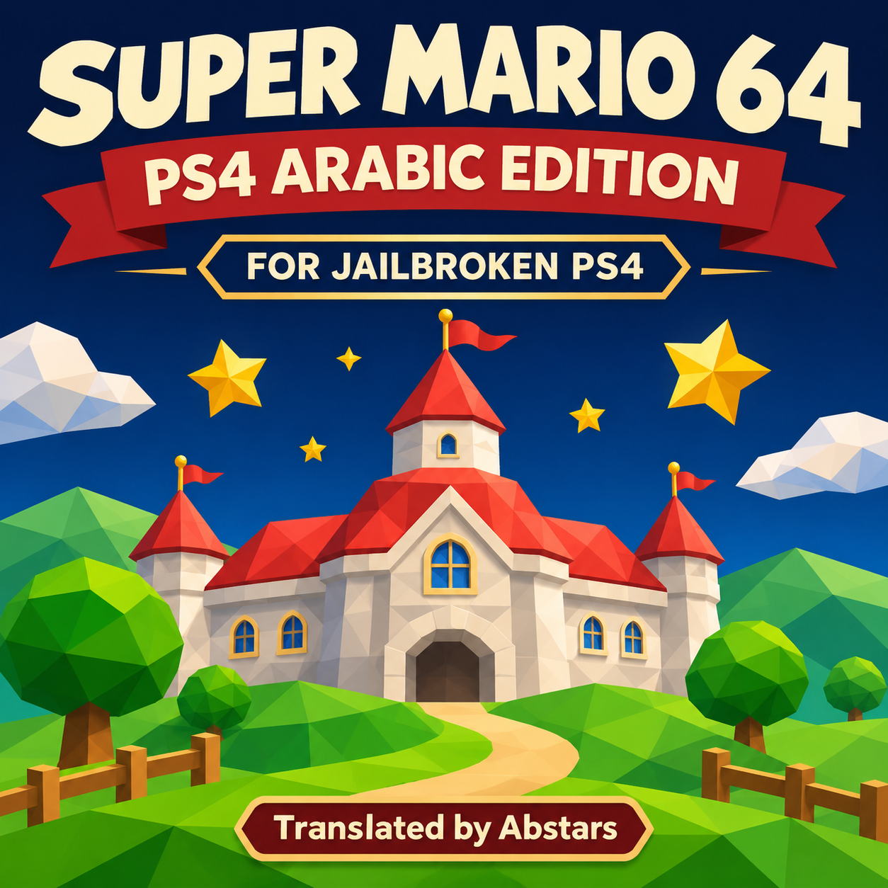
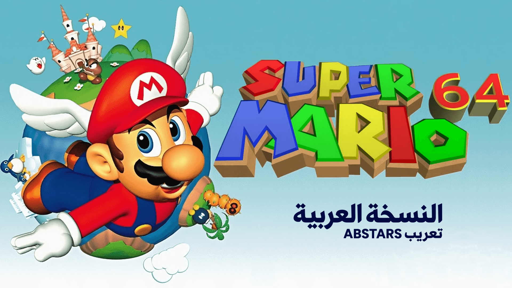
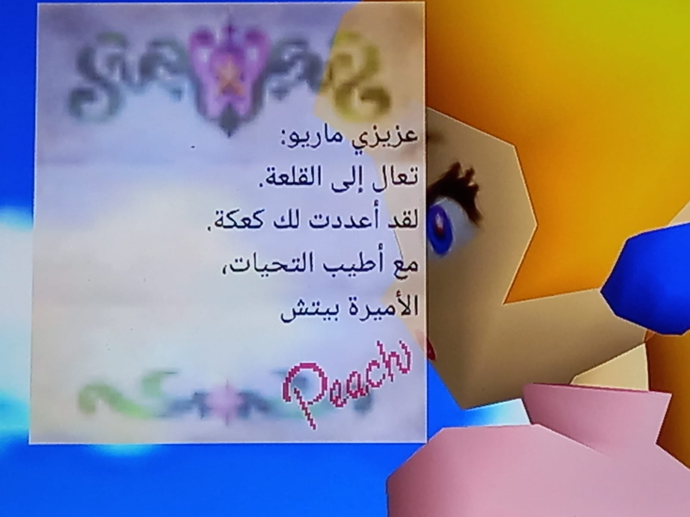
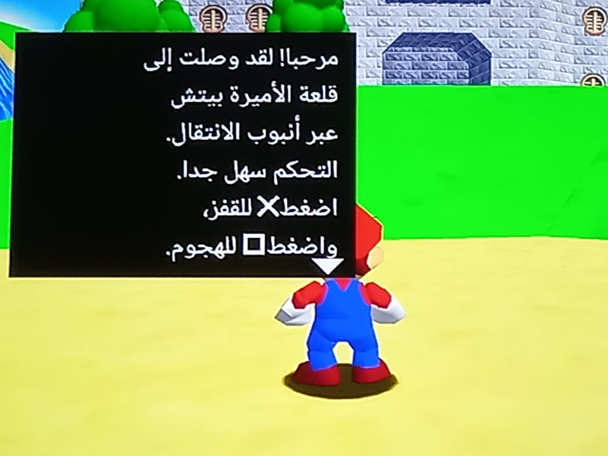
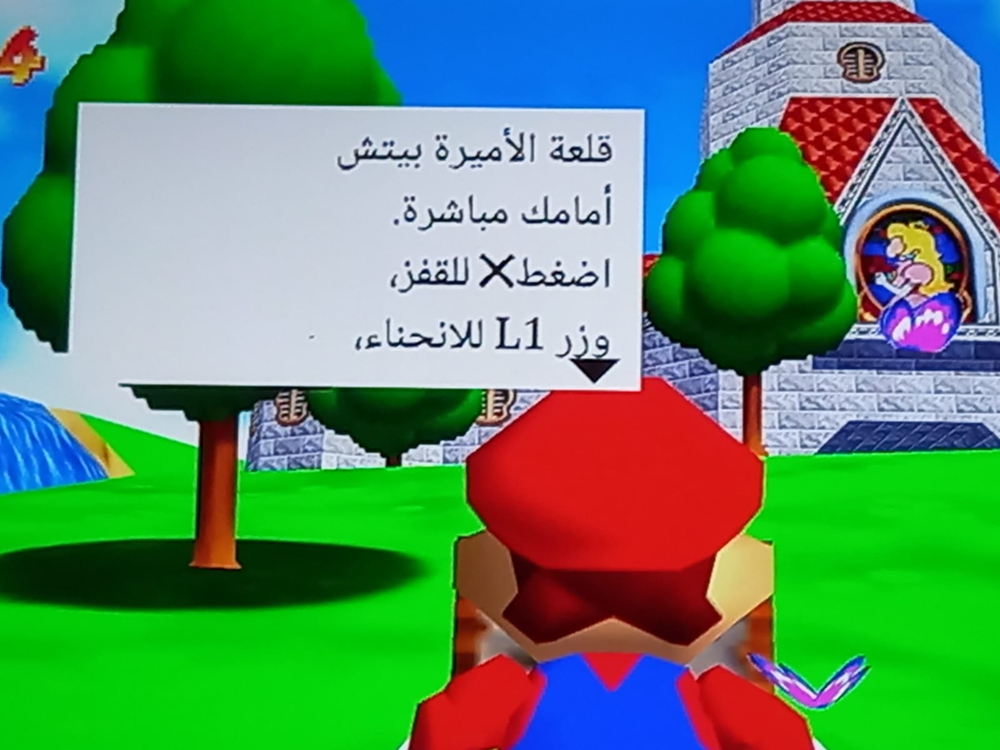

# سوبر ماريو 64 بالعربية على PS4 — الإصدار 1.0

**Arabic Edition · For jailbroken PS4 only**  
*Translated by Abstars*



من رسالة الأميرة بيتش إلى آخر نجمة قوة، يمكنك استكشاف عالم **سوبر ماريو 64** وقراءة حواراته وقوائمه بالعربية. هذا تعريب غير رسمي لنسخة اللعبة الأمريكية على بلايستيشن 4، من إعداد **ABSTARS** بالتعاون مع **ChatGPT**.

- **170 حوارا و90 عنوان مهمة و24 اسم مرحلة**، مع قوائم عربية لاختيار الملفات والمراحل، والإيقاف المؤقت، والحفظ.
- حروف عربية متصلة من اليمين إلى اليسار وخلفيات عالية التباين تسهّل القراءة على التلفاز.
- تعليمات بأزرار يد تحكم PS4، وترجمة لنصوص النهاية وأسماء فريق العمل.

An Arabic localization of the US Super Mario 64 PS4 port. It includes all **170 dialogs**, **90 mission titles**, **24 named stages**, file and pause menus, Peach’s letter, ending subtitles, and staff credits. Dialogs use right-to-left layout, connected Arabic lettering, higher-resolution text textures, and opaque boxes to help players read from a TV viewing distance. Instructions use PS4 controls, including ×, □, L1, R1, the right stick, and OPTIONS.

ABSTARS tested and approved the final localization build on PS4. The original “POWER” artwork remains in the health meter.

**PS4 only.** This edition requires a jailbroken PS4 configured to run homebrew packages. هذا الإصدار مخصص حصرا لأجهزة بلايستيشن 4 المعدلة لتشغيل حزم الهومبرو.

## شاشة التشغيل النهائية · Final launch splash



## من داخل اللعبة · PS4 screenshots

**رسالة الأميرة بيتش · Peach’s letter**



**الترحيب عند القلعة · Castle welcome**



**لافتة القلعة · Castle sign**



## Build from source

This repository provides the [localization patch](sm64-ps4-arabic.patch). You need a US ROM from your own copy of the game and a working [OpenOrbis PS4 toolchain](https://github.com/OpenOrbis/OpenOrbis-PS4-Toolchain), version 0.5 for the tested build. Follow the [upstream PS4 port instructions](https://github.com/OsirizX/sm64-port/tree/ps4) for the runtime modules and toolchain setup.

```sh
git clone https://github.com/dmtniptv/sm64-ps4-arabic-source.git
git clone --branch ps4 --recurse-submodules https://github.com/OsirizX/sm64-port.git
cd sm64-port
git checkout --detach 05356eef0b5b8bd595c35bdf0061eb22f54e9b4e
git submodule update --init --recursive
git apply --check ../sm64-ps4-arabic-source/sm64-ps4-arabic.patch
git apply ../sm64-ps4-arabic-source/sm64-ps4-arabic.patch
```

Place your `baserom.us.z64` in the port's root directory, then run:

```sh
make -j2 VERSION=us TARGET_PS4=1 ARABIC=1 pkg
```

The generated package goes in `build/`. The patch matches the final localization from `ef4d68f` and uses the upstream package artwork. The cover and splash above are previews. ROMs and prebuilt packages are kept out of this repository.

## Credits

- **ABSTARS** — Arabic localization project lead and PS4 playtesting.
- **Prepared in collaboration with ChatGPT** — Arabic localization, rendering, and build support.
- [OsirizX and the Super Mario 64 port contributors](https://github.com/OsirizX/sm64-port) — upstream PS4 port.
- [OpenOrbis](https://github.com/OpenOrbis/OpenOrbis-PS4-Toolchain) — PS4 toolchain.
- Nintendo — original game, characters, and assets.

This is an unofficial fan localization.
